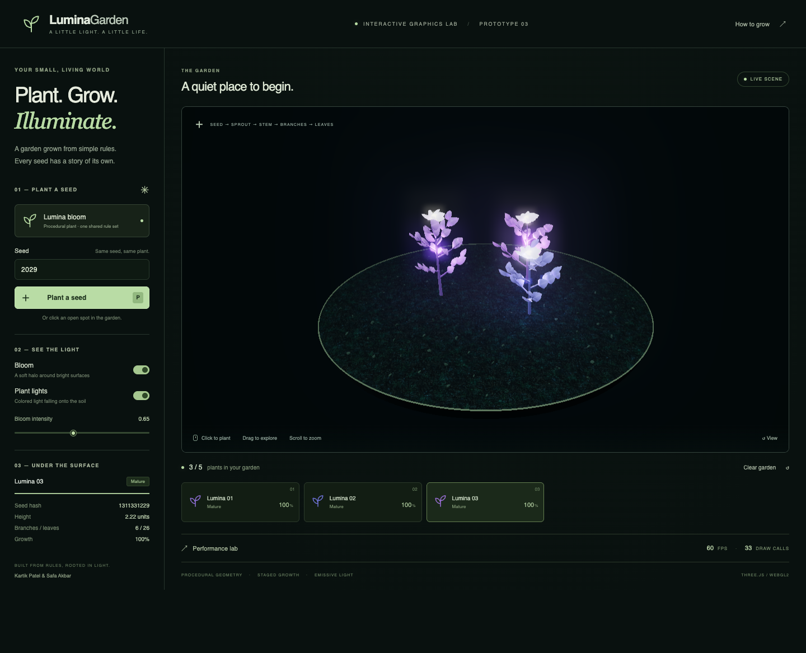

# LuminaGarden

An interactive bioluminescent garden built for Assignment 3 by **Kartik Patel
and Safa Akbar**. Click the ground to plant a seed and watch procedural stems,
branches, leaves, and petals grow in sequence. Each plant has an emissive
material and a colored point light; bloom adds the halo.



The Assignment 2 **PDF's narrow vertical slice** governs this prototype. The
presentation describes the broader semester plan. This build implements one
plant family, with a **hard maximum of five plants** as requested. It starts
with three mature example plants; clear the garden to demonstrate growth
from an empty scene.

## Run locally

Requires **Node.js 22.12 or newer**, npm, and a modern desktop browser with
WebGL2 and hardware acceleration. No API key or backend is needed.

```sh
npm ci
npm run dev
```

Open the Local URL printed by Vite, normally `http://127.0.0.1:5173`.

To run the compiled production build:

```sh
npm run build
npm run preview
```

Open the printed URL, normally `http://127.0.0.1:4173`. Use an HTTP server;
opening `dist/index.html` directly with `file://` will not work.

## Controls

- Click an open spot on the soil, or press **Plant a seed**. With the viewport
  focused, **P** also plants at the next available demo position.
- Enter a number or word in **Seed**. Reusing a seed reproduces the geometry;
  numeric seeds advance automatically after planting.
- Drag to orbit, scroll to zoom, and use **View** to restore the camera.
- **Bloom** toggles post-processing. **Plant lights** toggles ground
  illumination. Emissive surfaces remain visible when either is disabled.
- Select a plant card to inspect its seed hash, height, branch/leaf count,
  and current growth stage.
- **Clear garden** is a testing convenience. The five-plant cap applies to
  manual placement, button placement, the guided demo, and the benchmark.

## What is implemented

| Assignment 2 MVP requirement | Implementation |
| --- | --- |
| Click ground to plant one seed | Camera raycast onto the soil; drag detection prevents accidental planting |
| Varied procedural geometry | Seeded PRNG; bounded height, golden-angle branches, alternating leaf placement, color variation |
| Sprout → stem → branches → leaves | Nine-second reveal with base-anchored segment extension and independently scheduled organs |
| Emissive/glow materials | Custom GLSL leaf emission gradient, emissive stems/petals/flower centers |
| One colored point light per plant | Up to five independently colored Three.js point lights |
| Basic bloom in real time | EffectComposer → RenderPass → UnrealBloomPass → OutputPass |

Wind, movable lights, day/night, multiple species, and shadows remain outside
this vertical slice. Reset was added only to make repeated testing possible.

`simplex-noise`, `lil-gui`, and GSAP were proposed dependencies, not core MVP
features. This build uses a small seeded PRNG, HTML controls, and a shared
growth clock instead. These choices make geometry and reveal timing easy
to inspect. Three.js, TypeScript, WebGL2, and bloom match the selected stack.

## Core code

- [`src/generator.ts`](src/generator.ts): pure rules, seed hashing, constrained
  plant blueprints, reveal timing, and five benchmark positions.
- [`src/plant.ts`](src/plant.ts): instanced geometry, growth transforms, the
  GLSL emission gradient, and a point light for each plant.
- [`src/main.ts`](src/main.ts): renderer, raycasting, camera controls, bloom,
  inspection, benchmark, and the 150-second guided demo.
- [`public/textures/PROVENANCE.md`](public/textures/PROVENANCE.md): offline AI
  asset, generation prompt, and differences from the proposed asset tools.

The soil texture was created with OpenAI image generation and is bundled in
the build. The original Stable Diffusion/Midjourney mockups were not provided.
Plants, background, and stones are generated in code. No runtime AI call is
required by the MVP; the optional LLM naming stretch goal is deferred.

## Performance and stress test

Open **Performance lab → Run stress test**. It measures **1, 3, and 5 plants**
with bloom enabled at intensity 0.65 and one point light per plant. Each level
gets ten seconds for growth/shader warm-up, then eight seconds of real
`requestAnimationFrame` intervals. It exports average FPS, p95 frame time,
the slowest frame's equivalent FPS, draw calls, triangles, browser, GPU,
viewport, and pixel ratio. Keep the browser tab visible; hiding it cancels
the test. The lab replaces the current garden.

The original spec targets 60 FPS at 15–20 plants. The requested five-plant
limit means this prototype **does not validate that original workload**.
Measurements from the captured demo are in
[`docs/benchmark-results.json`](docs/benchmark-results.json). They describe
one browser/GPU/viewport, not a universal 60 FPS guarantee. Pixel ratio is
capped at 1.5, repeated organs are instanced, and mature plants stop uploading
growth matrices. Multiple point lights and bloom still have a cost.

## Checks

```sh
npm test
npm run build
npm run test:browser
```

The browser checks require a locally installed **Google Chrome**. They test
real click planting, all growth stages, seed replay, the five-plant limit,
bloom toggling, drag-versus-click behavior, cancellation, and a WebGL2
failure. Unit tests check deterministic generation and finite, bounded
geometry across 300 seeds.

## Assignment deliverables

- Report: [`docs/Assignment-3-Report.pdf`](docs/Assignment-3-Report.pdf), with
  editable source in [`docs/Assignment-3-Report.md`](docs/Assignment-3-Report.md).
  Regenerate using `npm run report` (Python 3, standard library only).
- Demo: `artifacts/LuminaGarden-Assignment3-Demo.webm`, recorded from the
  running production build with a real ground click, staged growth,
  explanatory text overlays, rendering comparisons, and the live stress
  test. Videos are ignored by Git to avoid committing large recordings.
- Demo walkthrough and upload steps: [`docs/DEMO.md`](docs/DEMO.md).
- Submission links/status: [`docs/SUBMISSION.md`](docs/SUBMISSION.md).
- Source remote: [KartikP12s/Lumina-Garden](https://github.com/KartikP12s/Lumina-Garden).

Record another demo after building:

```sh
npm run build
npm run record:demo
```

The script starts a local production preview, uses installed Chrome, captures
the actual page in real time, and saves new benchmark evidence. It does not
manufacture a 60 FPS result or speed up the footage. The complete recording
is approximately 2 minutes 45 seconds. To use an already running server, set
`LUMINA_URL` to its URL before running the script.

## Deploy to GitHub Pages

The included [workflow](.github/workflows/pages.yml) builds and deploys `dist/`
on a push to `main`, or when manually run. Relative Vite asset paths work
under the repository subpath.

1. Push this implementation and `package-lock.json` to the existing remote.
2. In the repository's **Settings → Pages → Build and deployment → Source**,
   select **GitHub Actions**.
3. Run the **Deploy LuminaGarden to GitHub Pages** workflow if it did not
   trigger automatically. Wait for successful build and deployment jobs.
4. Open the deployment's URL and verify click planting and bloom.
5. Keep the repository public to meet the assignment's source-code
   requirement. Its public visibility was verified using GitHub's API.

Expected URL after a successful deployment:
`https://kartikp12s.github.io/Lumina-Garden/`. This is a deployment target,
not a claim that a live site already exists. Hosting and YouTube/Vimeo upload
status are documented separately from completed local artifacts.

## Technical references

- [Three.js InstancedMesh](https://threejs.org/docs/pages/InstancedMesh.html)
- [Three.js UnrealBloomPass](https://threejs.org/docs/pages/UnrealBloomPass.html)
- [Three.js WebGLRenderer](https://threejs.org/docs/pages/WebGLRenderer.html)
- [GitHub Pages publishing source](https://docs.github.com/en/pages/getting-started-with-github-pages/configuring-a-publishing-source-for-your-github-pages-site)
- [GitHub Pages custom workflows](https://docs.github.com/en/pages/getting-started-with-github-pages/using-custom-workflows-with-github-pages)
