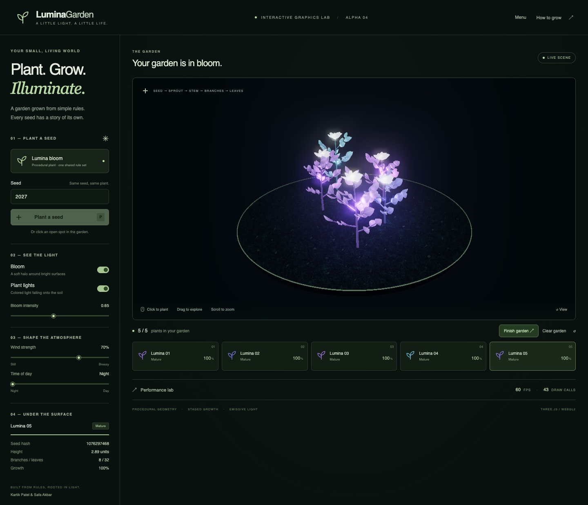

# LuminaGarden Alpha

An interactive bioluminescent garden by **Kartik Patel and Safa Akbar**,
now expanded for **Assignment 4 (MVP 2.0 / Alpha)**. Click the ground to plant a seed and watch procedural stems,
branches, leaves, and petals grow in sequence. Each plant has an emissive
material and a colored point light; bloom adds the halo.



The alpha adds a complete **Start → Grow & Shape → Finish → Restart** loop,
continuous coherent wind, and day/night lighting. Start Garden opens an
empty garden. Plant **one to five plants**, wait for all to mature, then
finish to see the summary. Grow Another Garden resets the scene and defaults.

**Playable:** https://lumina-garden-zeta.vercel.app/

The original Assignment 3 slice is retained: seeded variation, nine-second
staged growth, leaf emission GLSL, one colored point light per plant, and
bloom. Assignment 3 reports and benchmark data remain historical artifacts.

## Run locally

Requires **Node.js 22.12 or newer**, npm, and a modern desktop browser with
WebGL2 and hardware acceleration. No API key or backend is needed.

```sh
npm ci
npm run dev
```

Open the Local URL printed by Vite, normally `http://127.0.0.1:5173`.

To run the compiled production build:

```sh
npm run build
npm run preview
```

Open the printed URL, normally `http://127.0.0.1:4173`. Use an HTTP server;
opening `dist/index.html` directly with `file://` will not work.

## Controls

- Use **Start Garden** to begin. **Menu → Return to your garden** pauses and
  resumes the growth/wind clock. **Finish garden** becomes available once
  at least one plant is present and all planted seeds have matured.
- **Grow another garden** clears plants/lights and restores the seed,
  wind, daylight, bloom, and camera defaults.
- **Wind strength** controls a shared shader bend with seed-derived phase.
  **Time of day** changes background, fog, lighting, and glow readability.

- Click an open spot on the soil, or press **Plant a seed**. With the viewport
  focused, **P** also plants at the next available demo position.
- Enter a number or word in **Seed**. Reusing a seed reproduces the geometry;
  numeric seeds advance automatically after planting.
- Drag to orbit, scroll to zoom, and use **View** to restore the camera.
- **Bloom** toggles post-processing. **Plant lights** toggles ground
  illumination. Emissive surfaces remain visible when either is disabled.
- Select a plant card to inspect its seed hash, height, branch/leaf count,
  and current growth stage.
- **Clear garden** is a testing convenience. The five-plant cap applies to
  manual placement, button placement, the guided demo, and the benchmark.

## What is implemented

| Assignment 2 MVP requirement | Implementation |
| --- | --- |
| Click ground to plant one seed | Camera raycast onto the soil; drag detection prevents accidental planting |
| Varied procedural geometry | Seeded PRNG; bounded height, golden-angle branches, alternating leaf placement, color variation |
| Sprout → stem → branches → leaves | Nine-second reveal with base-anchored segment extension and independently scheduled organs |
| Emissive/glow materials | Custom GLSL leaf emission gradient, emissive stems/petals/flower centers |
| One colored point light per plant | Up to five independently colored Three.js point lights |
| Basic bloom in real time | EffectComposer → RenderPass → UnrealBloomPass → OutputPass |

Wind, day/night, and the session loop are integrated in the alpha.
Movable-light bending, additional species, and shadows remain in the
production schedule. Wind is a visual deformation, not botanical physics.

`simplex-noise`, `lil-gui`, and GSAP were proposed dependencies, not core MVP
features. This build uses a small seeded PRNG, HTML controls, and a shared
growth clock instead. These choices make geometry and reveal timing easy
to inspect. Three.js, TypeScript, WebGL2, and bloom match the selected stack.

## Core code

- [`src/generator.ts`](src/generator.ts): pure rules, seed hashing, constrained
  plant blueprints, reveal timing, and five benchmark positions.
- [`src/plant.ts`](src/plant.ts): instanced geometry, growth transforms, the
  GLSL emission gradient, and a point light for each plant.
- [`src/main.ts`](src/main.ts): session UI, renderer, raycasting, environment,
  camera, inspection, benchmark, and guided demo.
- [`src/environment.ts`](src/environment.ts): CPU wind field for light anchors
  and bounded day/night parameters.
- [`src/session.ts`](src/session.ts): guarded completion rule.
- [`public/textures/PROVENANCE.md`](public/textures/PROVENANCE.md): offline AI
  asset, generation prompt, and differences from the proposed asset tools.

The soil texture was created with OpenAI image generation and is bundled in
the build. The original Stable Diffusion/Midjourney mockups were not provided.
Plants, background, and stones are generated in code. No runtime AI call is
required by the MVP; the optional LLM naming stretch goal is deferred.

## Performance and stress test

Open **Performance lab → Run stress test**. It measures **1, 3, and 5 plants**
with bloom enabled at intensity 0.65 and one point light per plant. Each level
gets ten seconds for growth/shader warm-up, then eight seconds of real
`requestAnimationFrame` intervals. It uses the selected wind/daylight, records their values and effective bloom
strength, and exports average FPS, p95 frame time,
the slowest frame's equivalent FPS, draw calls, triangles, browser, GPU,
viewport, and pixel ratio. Keep the browser tab visible; hiding it cancels
the test. The lab replaces the current garden.

The original spec targets 60 FPS at 15–20 plants. The requested five-plant
limit means this prototype **does not validate that original workload**.
Measurements from the alpha production preview are in
[`docs/alpha/benchmark-results.json`](docs/alpha/benchmark-results.json). They describe
one browser/GPU/viewport, not a universal 60 FPS guarantee. Pixel ratio is
capped at 1.5, repeated organs are instanced, and mature plants stop uploading
growth matrices. Multiple point lights and bloom still have a cost.

## Checks

```sh
npm test
npm run build
npm run test:browser
```

The browser checks require a locally installed **Google Chrome**. Seven
unit tests and six browser tests cover deterministic geometry across 300
seeds, wind/root bounds, environment clamps, session completion, real click
planting, growth, seed replay, five-plant limits, dragging, pause/resume,
restart/resource bounds, environment controls, cancellation, and WebGL2 failure.

## Assignment 4 deliverables

- [Two-page report](docs/Assignment-4-Report.pdf): dated weekly schedule,
  final buffer week, release notes, known issues, and playable/source links.
- [Four-slide PowerPoint](docs/LuminaGarden-Assignment-4-Presentation.pptx)
  and [matching slide PDF](docs/LuminaGarden-Assignment-4-Presentation.pdf).
- [Speaker notes](docs/Assignment-4-Presentation-Notes.md): Kartik/Safa split,
  target 4:30, with two technical challenges and actual alpha measurements.
- [Editable production plan](docs/alpha/production-plan.json) and
  [release notes](docs/alpha/release-notes.json). The final submission date
  is tentatively December 14; the final buffer is December 7–13.
- [Alpha evidence](docs/alpha/evidence) and
  [benchmark](docs/alpha/benchmark-results.json).

To regenerate these documents (Python 3.12 recommended):

```sh
python3 -m venv .venv
.venv/bin/pip install -r scripts/requirements-docs.txt
.venv/bin/python scripts/create-alpha-deliverables.py
```

To recapture screenshots and benchmark evidence, first run `npm run build`
and `npm run preview`, then `node scripts/capture-alpha.mjs` in another
terminal. The capture script uses Chrome and the compiled app at port 4173.
Regenerate the documents after updating evidence or deployment status.

## Assignment 3 historical artifacts

- Report: [`docs/Assignment-3-Report.pdf`](docs/Assignment-3-Report.pdf), with
  editable source in [`docs/Assignment-3-Report.md`](docs/Assignment-3-Report.md).
  Regenerate using `npm run report` (Python 3, standard library only).
- Demo: `artifacts/LuminaGarden-Assignment3-Demo.webm`, recorded from the
  running production build with a real ground click, staged growth,
  explanatory text overlays, rendering comparisons, and the live stress
  test. Videos are ignored by Git to avoid committing large recordings.
- Demo walkthrough and upload steps: [`docs/DEMO.md`](docs/DEMO.md).
- Submission links/status: [`docs/SUBMISSION.md`](docs/SUBMISSION.md).
- Source remote: [KartikP12s/Lumina-Garden](https://github.com/KartikP12s/Lumina-Garden).

Record another demo after building:

```sh
npm run build
npm run record:demo
```

The script starts a local production preview, uses installed Chrome, captures
the actual page in real time, and saves new benchmark evidence. It does not
manufacture a 60 FPS result or speed up the footage. The complete recording
is approximately 2 minutes 45 seconds. The script now captures the current
alpha and writes new measurements under `docs/alpha/`, preserving the
Assignment 3 benchmark. To use an already running server, set
`LUMINA_URL` to its URL before running the script.

## Deploy to Vercel

The project is hosted on Vercel. `vercel.json` declares Vite, `npm run build`,
and the `dist` output directory. For a Vercel project connected to this GitHub
repository, pushes to its configured production branch trigger deployment.
The GitHub Actions workflow runs unit tests and a production build; hosting
is handled by Vercel.

After deployment, check the Start Garden menu, the full completion/restart
loop, wind during growth, and day/night. The HTML version marker is
`0.2.0-alpha`. See [deployment status](docs/alpha/deployment.json).

## Technical references

- [Three.js InstancedMesh](https://threejs.org/docs/pages/InstancedMesh.html)
- [Three.js UnrealBloomPass](https://threejs.org/docs/pages/UnrealBloomPass.html)
- [Three.js WebGLRenderer](https://threejs.org/docs/pages/WebGLRenderer.html)
- [Vercel GitHub deployment](https://vercel.com/docs/git/vercel-for-github)
